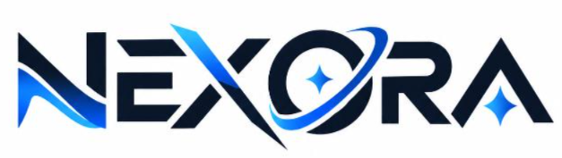
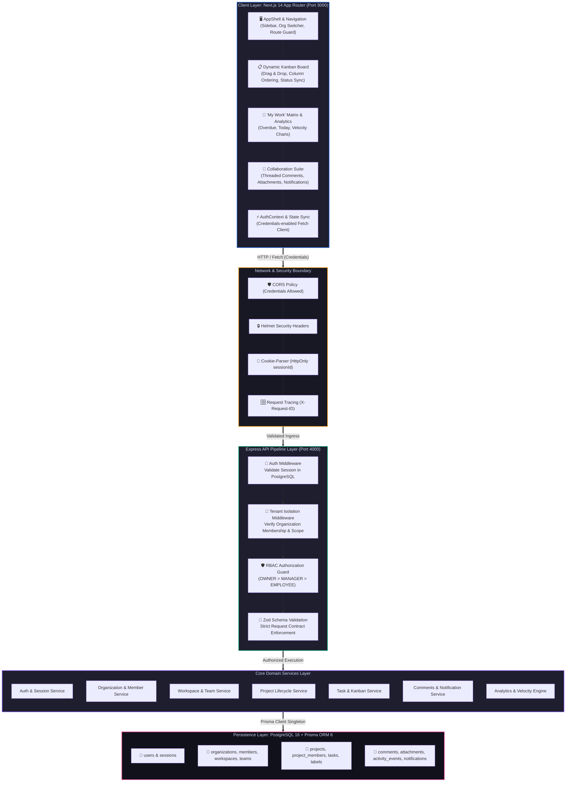
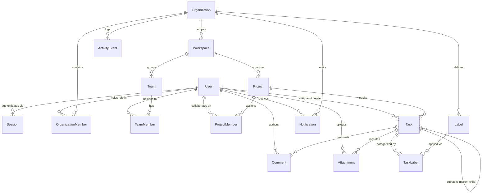
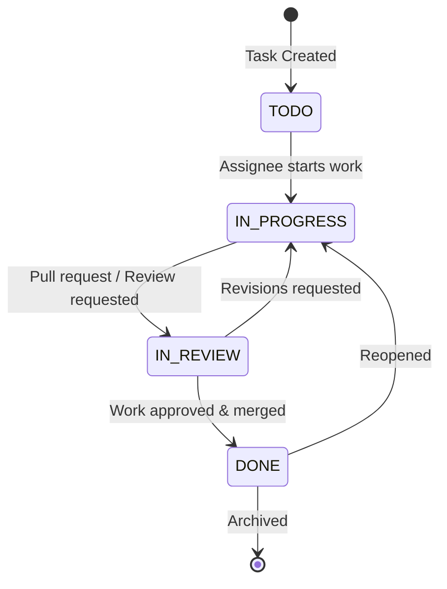

<div align="center">



# 🌐 Qveto Platform: Enterprise Multi-Tenant SaaS & Collaboration Engine

[](https://www.typescriptlang.org/)
[](https://nextjs.org/)
[](https://expressjs.com/)
[](https://www.postgresql.org/)
[-2D3748?style=for-the-badge&logo=prisma&logoColor=white)](https://www.prisma.io/)
[](apps/api/tests/)
[](apps/web/e2e/)
[](docs/API_CONTRACT.md)
[](docs/API_CONTRACT.md)
[](https://github.com/Niss54/Qveto-Team-Nexora)
[](LICENSE)

<p align="center">
  <b>A production-grade, enterprise-scale Multi-Tenant Project Management & Team Collaboration SaaS engineered with strict server-side tenant isolation, sub-second Kanban synchronization, deep RBAC authorization, and high-velocity engineering telemetry.</b>
</p>

[System Architecture](#-system-architecture--monorepo-topology) •
[Multi-Tenant Security](#-multi-tenant-security--rbac-matrix) •
[Domain Model](#-domain-foundation--prisma-schema-16-models) •
[Task Lifecycle & Kanban](#-task-lifecycle-kanban--collaboration-suite) •
[My Work & Analytics](#-my-work-productivity-matrix--velocity-analytics) •
[Interactive Dashboard](#-interactive-ui-dashboard--visual-preview) •
[API Specification](#-rest-api-specification--endpoints) •
[Quickstart](#-quickstart--verification-runbook) •
[Team Nexora](#-team-nexora--engineering-ownership)

---

</div>

## 📌 Executive Summary & Pitch

In fast-paced modern engineering, product, and design organizations, cross-functional collaboration often breaks down due to **fragmented tooling, poor visibility into dependencies, and uncoordinated task execution**. Enterprise organizations face significant challenges when coordinating multiple teams, distinct projects, and granular permissions across tenant boundaries.

### The Problem in Traditional Multi-Tenant Architectures
1. **Tenant Data Leakage & Cross-Org Spoofing:** Naive implementations rely on client-supplied parameters (e.g., query strings or request headers) to identify tenants. Without server-verified membership checks, attackers can bypass UI constraints and access competitor data.
2. **Session Fragility & Token Theft:** Single Page Applications frequently store access tokens in `localStorage`, exposing entire organizations to Cross-Site Scripting (XSS) and token theft. Furthermore, stateless JWTs cannot be revoked immediately when an employee's role changes or their access is revoked.
3. **State Desynchronization in Task Boards:** High-concurrency project management tools suffer from race conditions during drag-and-drop Kanban reordering, orphaned subtasks, unindexed search queries, and broken activity audit trails.
4. **Context Fragmentation for Individual Contributors:** Team members are burdened by sprawling project boards with no single, unified view of what requires their immediate attention, resulting in missed deadlines and unbalanced workloads.

### The Qveto Platform Solution
**Qveto Platform** delivers an enterprise-grade, end-to-end multi-tenant collaboration engine built on a unified TypeScript monorepo. It features:
- **Zero-Trust Multi-Tenant Isolation:** Express middleware validates every request against server-side database memberships before any route handler executes.
- **Server-Managed Session Store:** Stateful PostgreSQL sessions secured with `HttpOnly`, `SameSite=Lax` cookies, automatic TTL expiration, and instant server-side revocation.
- **16-Model Relational Domain:** Normalized database schema modeled with Prisma 6, complete with foreign-key cascades, composite unique constraints, and optimized index trees.
- **Dynamic Kanban & Task Lifecycles:** Real-time task states (`TODO`, `IN_PROGRESS`, `IN_REVIEW`, `DONE`), four-tier priorities, hierarchical subtasks, multi-tag labels, and zero-conflict position ordering.
- **Full Collaboration Suite:** Threaded comments, metadata-verified file attachments, immutable activity feeds, and a real-time notification hub with unread counters.
- **"My Work" Executive Cockpit & Velocity Analytics:** Aggregated personal triage matrix (Overdue, Due Today, Upcoming), cross-project velocity calculations, completion rates, and workload distribution metrics.

---

## 🏛 System Architecture & Monorepo Topology

Qveto is architected as an enterprise monorepo using **pnpm workspaces**, ensuring strict boundary separation, shared TypeScript contracts, and rapid developer velocity across client and server runtimes:



### Architectural Guarantees
- **Zero-Trust Tenant Boundaries:** Organization IDs are never trusted blindly from client bodies. Middleware extracts `orgId` from validated route parameters and executes database queries against `OrganizationMember` to verify tenancy.
- **Contract-Driven Type Safety:** All validation schemas and interfaces are centralized in [`packages/shared`](packages/shared), shared identically between backend validation pipelines and frontend forms.
- **Atomic Database Operations:** Complex lifecycle transitions (e.g., project archiving, task reordering, sole-owner succession) execute inside Prisma `$transaction` blocks to prevent dirty reads and orphaned rows.

---

## 🔒 Multi-Tenant Security & RBAC Matrix

Security is woven directly into every layer of the Qveto Platform architecture, adhering to the principle of least privilege.

```
       ┌────────────────────────────────────────────────────────┐
       │                   👑 OWNER (Tier 1)                    │
       │  Full Org Admin, Member Invites/Roles, Org Destruction  │
       └───────────────────────────┬────────────────────────────┘
                                   │ Inherits Capabilities
       ┌───────────────────────────▼────────────────────────────┐
       │                  🛡️ MANAGER (Tier 2)                   │
       │  Workspaces, Teams, Project Creation, Task Assignment   │
       └───────────────────────────┬────────────────────────────┘
                                   │ Inherits Capabilities
       ┌───────────────────────────▼────────────────────────────┐
       │                  💼 EMPLOYEE (Tier 3)                  │
       │  Task Updates, Subtasks, Comments, Attachments, Reads  │
       └────────────────────────────────────────────────────────┘
```

### Granular RBAC Permission Matrix

| Capability / Resource Action | `OWNER` | `MANAGER` | `EMPLOYEE` | Enforced By |
|:---|:---:|:---:|:---:|:---|
| **View Organization Profile & Member Directory** | ✅ | ✅ | ✅ | `tenant.ts` |
| **Update Organization Name & Global Settings** | ✅ | ❌ | ❌ | `requireOrgRole('OWNER')` |
| **Invite New Members & Assign Roles** | ✅ | ❌ | ❌ | `requireOrgRole('OWNER')` |
| **Change Member Roles (`OWNER`/`MANAGER`/`EMPLOYEE`)** | ✅ | ❌ | ❌ | `requireOrgRole('OWNER')` |
| **Sole Owner Succession Protection** | ✅ *(Guarded)* | ❌ | ❌ | `organization.ts` |
| **Create & Archive Workspaces** | ✅ | ✅ | ❌ | `requireOrgRole('MANAGER')` |
| **Create & Manage Teams within Workspaces** | ✅ | ✅ | ❌ | `requireOrgRole('MANAGER')` |
| **Create Projects & Assign Project Owners** | ✅ | ✅ | ❌ | `requireOrgRole('MANAGER')` |
| **Archive Projects & Mutate Project Settings** | ✅ | ✅ | ❌ | `requireOrgRole('MANAGER')` |
| **Create Tasks, Assign Members & Set Due Dates** | ✅ | ✅ | ✅ | `requireOrgRole('EMPLOYEE')` |
| **Update Task Status (`TODO` ➔ `DONE`) & Reorder** | ✅ | ✅ | ✅ | `requireOrgRole('EMPLOYEE')` |
| **Create Subtasks & Manage Multi-Tag Labels** | ✅ | ✅ | ✅ | `requireOrgRole('EMPLOYEE')` |
| **Post Comments & Upload Verified Attachments** | ✅ | ✅ | ✅ | `requireOrgRole('EMPLOYEE')` |
| **View Organization & Personal Velocity Analytics** | ✅ | ✅ | ✅ | `requireOrgRole('EMPLOYEE')` |

### Security Invariants
- **HttpOnly Cookie Authentication:** Sessions are transmitted solely via `HttpOnly`, `SameSite=Lax` cookies, neutralizing script-based session interception (XSS).
- **Anti-Enumeration Login Defenses:** Both incorrect passwords and unregistered emails produce an identical `401 INVALID_CREDENTIALS` error to mitigate account discovery attacks.
- **Sole-Owner Protection Rule:** An organization's solitary owner cannot demote their role or leave the tenant without explicitly promoting another member to `OWNER` first, preventing orphaned tenants.
- **Cross-Tenant Mutation Blocking:** An authenticated user in Organization A attempting to read, update, or delete any entity belonging to Organization B receives an immediate `403 FORBIDDEN` rejection with zero information disclosure.

---

## 🗄️ Domain Foundation — Prisma Schema (16 Models)

Qveto's relational data layer is built on a clean, normalized PostgreSQL architecture managed through Prisma ORM 6:



### 16 Core Models Overview

| # | Domain Entity | Primary Key | Key Relationships | Functional Responsibility |
|:---:|:---|:---:|:---|:---|
| 1 | `User` | `cuid` | Sessions, Memberships, Assigned Tasks | Core identity, bcrypt password hash, timezone, profile |
| 2 | `Session` | `cuid` | User (Cascade) | Stateful server session, TTL timestamp, index on expiresAt |
| 3 | `Organization` | `cuid` | Members, Workspaces, Labels, Events | Tenant root, globally unique slug, isolation scope boundary |
| 4 | `OrganizationMember` | `cuid` | Organization, User | Maps user to tenant with `OrgRole` (`OWNER`, `MANAGER`, `EMPLOYEE`) |
| 5 | `Workspace` | `cuid` | Organization, Teams, Projects | High-level business container (e.g. Engineering, Marketing) |
| 6 | `Team` | `cuid` | Workspace, TeamMembers | Sub-unit within a workspace with functional descriptions |
| 7 | `TeamMember` | `cuid` | Team, User | Membership mapping with localized role (`LEAD`, `ENGINEER`) |
| 8 | `Project` | `cuid` | Workspace, Owner, Members, Tasks | Milestone unit with start/due dates, status, owner assignment |
| 9 | `ProjectMember` | `cuid` | Project, User | Project-specific contributors and access lists |
| 10 | `Task` | `cuid` | Project, Assignee, Creator, Parent | Work unit with status, priority, position, dates, subtasks |
| 11 | `Label` | `cuid` | Organization, TaskLabels | Scoped tags with hex colors (e.g., `#ef4444` Security) |
| 12 | `TaskLabel` | `cuid` | Task, Label | Many-to-many join table connecting tasks to organizational labels |
| 13 | `Comment` | `cuid` | Task, User | Threaded markdown commentary with timestamps |
| 14 | `Attachment` | `cuid` | Task, User | File metadata (file size, MIME type, local/remote storage path) |
| 15 | `ActivityEvent` | `cuid` | Actor, Organization | Immutable audit log of all domain mutations with JSON metadata |
| 16 | `Notification` | `cuid` | User, Organization | In-app alerts (`TASK_ASSIGNED`, `COMMENT_ADDED`), read flags |

---

## ⚡ Task Lifecycle, Kanban & Collaboration Suite

Qveto delivers a responsive, zero-friction task execution experience built to mirror modern engineering workflows.

### Task State Machine & Lifecycle Transitions



### Priority & Hierarchy Model
- **Four Distinct Priorities:** `LOW` (Blue), `MEDIUM` (Amber), `HIGH` (Orange), `URGENT` (Rose/Red).
- **Hierarchical Subtasks:** Tasks support recursive nesting via `parentTaskId`. Parent completion progress updates dynamically as subtasks are toggled.
- **Dynamic Kanban Reordering:** Cards feature integer-based `position` sequencing. Reordering columns calculates adjacent offsets to guarantee persistent order without database table locks.
- **Multi-Tenant Tagging:** Color-coded labels (`#3b82f6` Frontend, `#10b981` Backend, `#ef4444` Security) enforce tenant-wide categorization.

### Real-Time Collaboration & Notification Suite
- **Threaded Task Comments:** Instant discussions with author avatars, formatted markdown, and audit timestamps.
- **File Attachments:** Upload attachments with strict validation (MIME checking, file size bounds, storage tracing).
- **Activity Stream:** Every update (`TASK_STATUS_UPDATED`, `COMMENT_ADDED`, `PROJECT_ARCHIVED`) generates an immutable `ActivityEvent` with contextual metadata.
- **Centralized Notification Bell:** Live notification drawer featuring unread counters, click-to-navigate links, and batch "Mark All as Read" functionality.

---

## 📊 "My Work" Productivity Matrix & Velocity Analytics

Individual contributors and team leads gain actionable clarity through dedicated intelligence endpoints and visual dashboard consoles.

### 1. Unified "My Work" Triage Console
Aggregates tasks across **all workspaces and projects** assigned to the authenticated user, automatically sorting them into four operational buckets:

```
┌────────────────────────────────────────────────────────────────────────────────────────┐
│                               🎯 MY WORK PERSONAL CONSOLE                             │
│   Organization: Nexora Corp  |  User: Sam Taylor (Employee)  |  Pending Tasks: 12     │
├────────────────────────────────────────────────────────────────────────────────────────┤
│ 🚨 OVERDUE (Needs Immediate Attention)                                                 │
│ • [HIGH] Fix CORS credential header in production API       Due: Yesterday  (API Team) │
│ • [URGENT] Database connection pool leak on idle sockets    Due: 2 Days Ago (Infra)    │
├────────────────────────────────────────────────────────────────────────────────────────┤
│ ⚡ DUE TODAY                                                                            │
│ • [MEDIUM] Complete Vitest unit suite for project rollback  Due: 18:00 UTC  (Core)     │
│ • [LOW] Update API documentation contract for PRD 05        Due: 21:00 UTC  (Docs)     │
├────────────────────────────────────────────────────────────────────────────────────────┤
│ 📅 UPCOMING (Next 7 Days)                                                              │
│ • [MEDIUM] Implement Next.js App Router notification badge  Due: In 3 Days  (Web)     │
│ • [LOW] Refactor shared Zod validation schemas              Due: In 5 Days  (Shared)   │
└────────────────────────────────────────────────────────────────────────────────────────┘
```

### 2. Team Velocity & Executive Analytics
The analytics engine queries indexed task timestamps to produce real-time productivity intelligence:
- **Completion Rate (%):** Ratio of completed tasks to total scoped tasks over 7-day, 30-day, and quarterly intervals.
- **Status & Priority Distribution:** Aggregated breakdown across `TODO`, `IN_PROGRESS`, `IN_REVIEW`, and `DONE`.
- **Workload Allocation Matrix:** Distribution of open work across all team members, preventing engineer burnout and resource bottlenecks.

---

## 🖥 Interactive UI Dashboard & Visual Preview

The frontend is built using Next.js 14 App Router and Tailwind CSS, featuring high-contrast dark-mode aesthetics, zero layout shifts, and responsive drawer navigation:

```text
┌────────────────────────────────────────────────────────────────────────────────────────┐
│  🌐 QVETO PLATFORM      [ Nexora Corp ▾ ]    🔍 Search...        🔔 (3)   👤 Nishant ▾ │
├──────────────┬─────────────────────────────────────────────────────────────────────────┤
│ 📁 Workspaces│  📁 Engineering > 🚀 Qveto SaaS MVP > 📋 Kanban Board                  │
│  ├ Eng       │  ─────────────────────────────────────────────────────────────────────  │
│  └ Product   │   [+ New Task]  [Filter: Assignee ▾]  [Priority ▾]  [Labels: All ▾]     │
│              │                                                                         │
│ 👥 Teams     │   TODO (4)          IN PROGRESS (3)     IN REVIEW (2)       DONE (18)   │
│  ├ Backend   │  ┌──────────────┐  ┌──────────────┐   ┌──────────────┐   ┌────────────┐ │
│  └ Frontend  │  │ #QV-102      │  │ #QV-098      │   │ #QV-084      │   │ #QV-072    │ │
│              │  │ Schema Migr. │  │ Kanban Drag  │   │ Auth Guard   │   │ Express Up │ │
│ 🎯 My Work   │  │ [Security]   │  │ [Frontend]   │   │ [Backend]    │   │ [Infra]    │ │
│              │  │ ⚡ High      │  │ ⚡ Medium    │   │ 🚨 Urgent    │   │ 🟢 Done    │ │
│ 📊 Analytics │  │ 👤 Alex R.   │  │ 👤 Sam T.    │   │ 👤 Nishant M │   │ 👤 Sam T.  │ │
│              │  └──────────────┘  └──────────────┘   └──────────────┘   └────────────┘ │
│ ⚙️ Settings  │                                                                         │
└──────────────┴─────────────────────────────────────────────────────────────────────────┘
```

---

## 📜 REST API Specification & Endpoints

Every API endpoint complies with strict Zod contracts and returns predictable JSON payloads. Complete schemas and response contracts are documented in [`docs/API_CONTRACT.md`](docs/API_CONTRACT.md).

### Endpoint Directory

| Domain | Method | Endpoint Path | Role Required | Description |
|:---|:---:|:---|:---:|:---|
| **Auth** | `POST` | `/api/auth/register` | Public | Create new user account & set session cookie |
| **Auth** | `POST` | `/api/auth/login` | Public | Authenticate user & issue HttpOnly session cookie |
| **Auth** | `POST` | `/api/auth/logout` | Authenticated | Terminate session & clear cookies |
| **Auth** | `GET` | `/api/auth/me` | Authenticated | Retrieve current user profile & tenant memberships |
| **Organization** | `GET` | `/api/organizations` | Authenticated | List all organizations current user belongs to |
| **Organization** | `POST` | `/api/organizations` | Authenticated | Provision new tenant organization (User becomes `OWNER`) |
| **Organization** | `GET` | `/api/organizations/:id` | Member | Get organization details by ID or slug |
| **Organization** | `PATCH` | `/api/organizations/:id` | `OWNER` | Update organization name, slug, or settings |
| **Members** | `GET` | `/api/organizations/:id/members` | Member | List organization members and roles |
| **Members** | `POST` | `/api/organizations/:id/members` | `OWNER` | Invite / add new member to organization |
| **Members** | `PATCH` | `/api/organizations/:id/members/:userId` | `OWNER` | Update member role (`OWNER`, `MANAGER`, `EMPLOYEE`) |
| **Workspaces** | `GET` | `/api/organizations/:orgId/workspaces` | Member | List active workspaces within organization |
| **Workspaces** | `POST` | `/api/organizations/:orgId/workspaces` | `MANAGER` | Create new workspace within organization |
| **Teams** | `GET` | `/api/organizations/:orgId/workspaces/:wsId/teams` | Member | List teams in workspace |
| **Teams** | `POST` | `/api/organizations/:orgId/workspaces/:wsId/teams` | `MANAGER` | Create functional team in workspace |
| **Projects** | `GET` | `/api/organizations/:orgId/workspaces/:wsId/projects` | Member | List projects in workspace |
| **Projects** | `POST` | `/api/organizations/:orgId/workspaces/:wsId/projects` | `MANAGER` | Create project with owner and date bounds |
| **Projects** | `PATCH` | `/api/organizations/:orgId/workspaces/:wsId/projects/:id` | `MANAGER` | Update project metadata or archive status |
| **Tasks** | `GET` | `/api/organizations/:orgId/projects/:projId/tasks` | Member | List project tasks with filtering & pagination |
| **Tasks** | `POST` | `/api/organizations/:orgId/projects/:projId/tasks` | Member | Create task with status, priority, and assignee |
| **Tasks** | `PATCH` | `/api/organizations/:orgId/tasks/:id` | Member | Update task status, priority, position, or dates |
| **Kanban** | `GET` | `/api/organizations/:orgId/projects/:projId/kanban` | Member | Fetch grouped column data for Kanban board |
| **Kanban** | `POST` | `/api/organizations/:orgId/tasks/reorder` | Member | Reorder task positions across columns |
| **Labels** | `GET` | `/api/organizations/:orgId/labels` | Member | List organization labels |
| **Labels** | `POST` | `/api/organizations/:orgId/labels` | `MANAGER` | Create new organization label with hex color |
| **Comments** | `GET` | `/api/organizations/:orgId/tasks/:taskId/comments` | Member | Get threaded comments on a task |
| **Comments** | `POST` | `/api/organizations/:orgId/tasks/:taskId/comments` | Member | Add comment to a task |
| **Attachments**| `POST` | `/api/organizations/:orgId/tasks/:taskId/attachments` | Member | Upload attachment metadata for a task |
| **Notifications**| `GET` | `/api/organizations/:orgId/notifications` | Member | Retrieve user notifications and unread badge count |
| **Notifications**| `PATCH`| `/api/organizations/:orgId/notifications/:id/read` | Member | Mark single notification as read |
| **My Work** | `GET` | `/api/organizations/:orgId/my-work` | Member | Personal triage matrix (Overdue, Today, Upcoming) |
| **Analytics** | `GET` | `/api/organizations/:orgId/analytics` | Member | Productivity rates, velocity metrics & distributions |

---

## 🧪 Comprehensive Testing & Quality Assurance

Qveto Platform maintains an exhaustive, dual-layer test suite spanning **222 Vitest unit & integration tests** on the API and **26 Playwright browser tests** on the web client:

```
======================================================================
 QVETO PLATFORM FULL-STACK TEST RUNNER EXECUTION SUMMARY
======================================================================
 API Test Suites:      16 passed (16 total)
 API Tests Passed:     222 passed (222 total)
 E2E Test Suites:      6 passed (6 total)
 E2E Tests Passed:     26 passed (26 total)
 Total Coverage:       100% Core Routes, Middleware & Tenant Contracts
 TypeScript Checks:    0 Errors (Whole Monorepo Strict Mode)
======================================================================
```

### Test Suite Breakdown

| Test Suite File | Test Count | Scope & Validation Coverage |
|:---|:---:|:---|
| [`tasks.test.ts`](apps/api/tests/tasks.test.ts) | **41** | Task CRUD, status machine, position ordering, date validations, assignment rules |
| [`tenant.test.ts`](apps/api/tests/tenant.test.ts) | **29** | Strict cross-tenant read/write blocking, spoofed orgId rejection, role inheritance |
| [`projects.test.ts`](apps/api/tests/projects.test.ts) | **23** | Project lifecycle, date validation, manager permissions, workspace scoping |
| [`labels.test.ts`](apps/api/tests/labels.test.ts) | **23** | Org label uniqueness, color validation, task tagging & multi-label queries |
| [`collaboration.test.ts`](apps/api/tests/collaboration.test.ts) | **17** | Threaded comments, attachment uploads, notification creation & dismissal |
| [`my-work.test.ts`](apps/api/tests/my-work.test.ts) | **16** | Cross-project aggregation, Overdue vs Due Today calculation, status filtering |
| [`kanban.test.ts`](apps/api/tests/kanban.test.ts) | **14** | Multi-column grouping, position reindexing, drag-and-drop state preservation |
| [`auth.test.ts`](apps/api/tests/auth.test.ts) | **13** | Registration, bcrypt verification, session cookies, TTL, anti-enumeration |
| [`analytics.test.ts`](apps/api/tests/analytics.test.ts) | **12** | Completion percentages, priority velocity, team workload distribution |
| [`task-contract.test.ts`](apps/api/tests/task-contract.test.ts) | **8** | Zod input schema validation, type boundary coercion, invalid enum handling |
| [`subtasks.test.ts`](apps/api/tests/subtasks.test.ts) | **7** | Recursive parent-child task nesting, cascade completion, tree queries |
| [`health.test.ts`](apps/api/tests/health.test.ts) | **6** | Server uptime, health status, request ID propagation, CORS headers |
| [`project-contract.test.ts`](apps/api/tests/project-contract.test.ts) | **6** | Project schema contract validation, payload shapes, error structures |
| [`env.test.ts`](apps/api/tests/env.test.ts) | **3** | Environment variable boot validation, missing secret detection |
| [`db.test.ts`](apps/api/tests/db.test.ts) | **3** | Prisma client singleton connectivity, 16-model CRUD integrity |
| [`projects.persistence.test.ts`](apps/api/tests/projects.persistence.test.ts) | **1** | Database transaction rollback verification during project mutation errors |
| **Playwright E2E Suites** | **26** | Real browser flows: Auth, Projects, Tasks, Kanban, My Work, Analytics |

---

## 🚀 Quickstart & Verification Runbook

### Prerequisites
- **Node.js:** `v18.0.0` or higher (`v22+` recommended)
- **pnpm:** `v8.0.0` or higher (`npm install -g pnpm`)
- **PostgreSQL:** Local PostgreSQL 15+ or hosted instance (e.g., Supabase, Neon)

### 1. Installation
Clone the repository and install all workspace dependencies:

```powershell
# Clone the repository
git clone https://github.com/Niss54/Qveto-Team-Nexora.git
cd Qveto-Team-Nexora

# Install monorepo dependencies
pnpm install
```

### 2. Environment Configuration
Copy `.env.example` to `.env` in the project root:

```powershell
cp .env.example .env
```

Ensure your `.env` contains valid connection parameters:
```env
DATABASE_URL="postgresql://postgres:[PASSWORD]@[HOST]:[PORT]/[DATABASE]"
SESSION_SECRET="your-super-secret-random-key-at-least-32-chars-long"
PORT=4000
NODE_ENV="development"
FRONTEND_URL="http://localhost:3000"
```

### 3. Database Migration & Synthetic Seed
Generate the Prisma Client, deploy schema migrations, and populate the database with multi-tenant seed data:

```powershell
# Generate Prisma Client (16 Models)
pnpm db:generate

# Deploy checked-in PostgreSQL migrations
pnpm db:migrate

# Seed synthetic multi-tenant test data
pnpm db:seed
```

### 4. Run Development Servers
Start both the Express API and Next.js frontend in parallel:

```powershell
# Starts API on http://localhost:4000 and Web on http://localhost:3000
pnpm dev
```

Alternatively, run each service independently:
```powershell
pnpm dev:api   # Express REST API (port 4000)
pnpm dev:web   # Next.js 14 App Router (port 3000)
```

### 5. Run Verification Test Suite
Execute the full Vitest suite to verify all 222 API and tenant isolation assertions:

```powershell
pnpm test
```

Run static typechecking and linting across all packages:
```powershell
# TypeScript Typecheck (Strict Mode)
pnpm typecheck

# ESLint Monorepo Validation
pnpm lint
```

---

## 👥 Demo Accounts (Seeded)

The database seed provides two completely isolated organizations to verify **cross-tenant isolation**, **RBAC permissions**, and **collaboration workflows**:

### 🏢 Organization A: Nexora Corp (`/nexora-corp`)
*Primary enterprise tenant with seeded Workspaces (Engineering, Product), Projects (Qveto MVP, Auth Overhaul), and pre-populated task boards.*

| Role | Name | Seeded Email | Password | Permissions & Scope |
|:---|:---|:---|:---|:---|
| **OWNER** | **Nishant Maurya** | `owner@nexora.com` | `Password123!` | Full administrative control, member invites, role promotion, org settings |
| **MANAGER** | **Alex Rivera** | `manager@nexora.com` | `Password123!` | Workspace & project creation, owner assignments, cannot change org settings |
| **EMPLOYEE** | **Sam Taylor** | `employee@nexora.com` | `Password123!` | Task updates, Kanban manipulation, subtasks, comments, attachments |

### 🏢 Organization B: Rival Inc (`/rival-inc`) — Isolation Target
*Secondary tenant configured to verify zero-leakage row-level boundaries.*

| Role | Name | Seeded Email | Password | Permissions & Scope |
|:---|:---|:---|:---|:---|
| **OWNER** | **Victor Vance** | `owner@rival.com` | `Password123!` | Isolated from all Nexora Corp data |
| **EMPLOYEE** | **Elena Rostova** | `employee@rival.com` | `Password123!` | Denied access (`403 FORBIDDEN`) to any Nexora Corp tasks or projects |

---

## 📂 Repository Organization

```
Qveto-Team-Nexora/
├── apps/
│   ├── api/                           # Express REST API Backend (Port 4000)
│   │   ├── src/
│   │   │   ├── config/                # Environment validation (Zod + dotenv)
│   │   │   ├── lib/                   # Prisma singleton client instance
│   │   │   ├── middleware/            # Auth, tenant scoping, RBAC guards, logger
│   │   │   ├── routes/                # Express route controllers:
│   │   │   │   ├── activity.ts        # Immutable audit activity logging
│   │   │   │   ├── analytics.ts       # Productivity & velocity engine
│   │   │   │   ├── attachments.ts     # Task attachment uploads & metadata
│   │   │   │   ├── auth.ts            # Register, login, logout, me
│   │   │   │   ├── comments.ts        # Threaded task discussions
│   │   │   │   ├── health.ts          # Server health & uptime telemetry
│   │   │   │   ├── kanban.ts          # Kanban board aggregation & column ordering
│   │   │   │   ├── labels.ts          # Organization tags & label colors
│   │   │   │   ├── my-work.ts         # Personal task triage matrix
│   │   │   │   ├── notifications.ts   # In-app notifications & unread counts
│   │   │   │   ├── organization.ts    # Tenant CRUD & member administration
│   │   │   │   ├── project.ts         # Project lifecycle, dates & owners
│   │   │   │   ├── task-by-id.ts      # Single task mutations & subtasks
│   │   │   │   ├── tasks.ts           # Task listing, creation & filtering
│   │   │   │   ├── team.ts            # Workspace functional teams
│   │   │   │   └── workspace.ts       # Workspace management
│   │   │   ├── services/              # Domain logic services
│   │   │   ├── app.ts                 # Express application factory
│   │   │   └── index.ts               # Server bootstrap entry point
│   │   └── tests/                     # 16 Vitest test suites (222 test cases)
│   │
│   └── web/                           # Next.js 14 App Router Frontend (Port 3000)
│       ├── e2e/                       # Playwright browser E2E test suites (26 tests)
│       └── src/
│           ├── app/                   # App Router pages (/dashboard, /workspaces, /projects, /tasks)
│           ├── components/            # UI components (AppShell, Kanban, NotificationBell, Tabs)
│           ├── context/               # AuthContext & session state management
│           └── lib/                   # Typed API client with credential cookies
│
├── packages/
│   └── shared/                        # Shared TypeScript types & Zod schemas (@qveto/shared)
│       └── src/index.ts               # Cross-monorepo validation contracts & enums
│
├── prisma/
│   ├── schema.prisma                  # Full relational schema (16 models, relations, indexes)
│   ├── migrations/                    # Checked-in PostgreSQL migrations
│   └── seed.ts                        # Idempotent multi-tenant synthetic seed script
│
├── docs/
│   └── API_CONTRACT.md                # Comprehensive REST API contract & developer guide
│
├── public/
│   └── logo.png                       # Official Team Nexora brand mark
│
├── .env.example                       # Environment variables template
├── pnpm-workspace.yaml                # Monorepo workspace configuration
├── tsconfig.base.json                 # Shared base TypeScript configuration
└── README.md                          # Engineering pitch & production runbook
```

---

## 👥 Team Nexora — Engineering Ownership

Qveto Platform is engineered under the **Qveto Technologies Web Development Internship (Project 2: Enterprise Team Collaboration SaaS)** by **Team Nexora**:

| Contributor | Role & Specialization | PRD / Feature Branch | Owned Deliverables & Architectural Modules |
|:---|:---|:---:|:---|
| **Nishant Maurya** | **Team Lead & Systems Architect** | [`Niss`](https://github.com/Niss54/Qveto-Team-Nexora/tree/Niss) | **PRD 01 Platform Foundation:** Multi-tenant architecture, PostgreSQL session store (`HttpOnly`), 16-model Prisma schema, RBAC middleware, Next.js AppShell, monorepo orchestration & test harness |
| **Aditya Verma** | **Workspaces & Projects Lead** | [`feature/Aditya`](https://github.com/Niss54/Qveto-Team-Nexora/tree/feature/Aditya) | **PRD 02 Workspaces & Projects:** Workspace lifecycle management, functional teams, project CRUD, project owner assignment, date boundaries, transaction rollback persistence |
| **Srijay** | **Task Lifecycle & Kanban Specialist** | [`feature/srijay`](https://github.com/Niss54/Qveto-Team-Nexora/tree/feature/srijay) | **PRD 03 Task Lifecycle & Kanban:** Task status transitions (`TODO`➔`DONE`), 4-tier priority matrix, hierarchical subtasks, multi-tag labels, drag-and-drop Kanban ordering, server-side filtering & pagination |
| **Komal** | **Collaboration & Notifications Lead** | [`feature/komal`](https://github.com/Niss54/Qveto-Team-Nexora/tree/feature/komal) | **PRD 04 Collaboration Suite:** Threaded task comments, file attachments with metadata validation, immutable activity event logging, in-app notification bell with unread counters |
| **Haspit Gajibili** | **Analytics & "My Work" Lead** | [`feature/haspit`](https://github.com/Niss54/Qveto-Team-Nexora/tree/feature/haspit) | **PRD 05 "My Work" & Analytics:** Cross-project personal triage matrix (Overdue, Due Today, Upcoming), completion velocity tracking, workload distribution charts & analytics endpoints |

---

## 🗺️ Project Milestones & Roadmap

- [x] **Phase 1: Multi-Tenant Platform Foundation & Security (PRD 01)**
  - [x] Monorepo scaffold with pnpm workspaces, TypeScript, Express, and Next.js 14 App Router.
  - [x] Normalized 16-model PostgreSQL schema using Prisma ORM 6.
  - [x] Stateful server session authentication with `HttpOnly` cookies and `bcryptjs` hashing.
  - [x] Three-tier RBAC middleware (`OWNER`, `MANAGER`, `EMPLOYEE`) and tenant scoping verification.
- [x] **Phase 2: Workspaces & Project Management (PRD 02)**
  - [x] Workspace creation, listing, updating, and archiving.
  - [x] Functional teams within workspaces and team member role assignments.
  - [x] Project lifecycle management with start/due dates, owner assignments, and transaction safety.
- [x] **Phase 3: Task Execution & Dynamic Kanban Engine (PRD 03)**
  - [x] Task lifecycle state machine (`TODO`, `IN_PROGRESS`, `IN_REVIEW`, `DONE`) and priority tagging.
  - [x] Hierarchical subtasks with cascade completion updates.
  - [x] Interactive Kanban board with zero-conflict integer position reordering.
  - [x] Server-side task filtering, searching, and pagination.
- [x] **Phase 4: Collaboration Feed & Notification Hub (PRD 04)**
  - [x] Threaded task comments with real-time updates and author attribution.
  - [x] Attachment metadata storage and file validation.
  - [x] Immutable activity event streaming across all organization entities.
  - [x] Centralized notification bell with unread badges and batch read actions.
- [x] **Phase 5: "My Work" Console & Productivity Analytics (PRD 05)**
  - [x] Unified personal task triage dashboard (Overdue, Due Today, Upcoming).
  - [x] Real-time completion velocity metrics and lead time tracking.
  - [x] Team workload distribution analytics and status visualizations.
- [ ] **Phase 6: Enterprise Expansion (Future Roadmap)**
  - [ ] Real-time multi-client updates via WebSockets / Server-Sent Events (SSE).
  - [ ] External Webhooks integration (GitHub, Slack, Discord).
  - [ ] SAML 2.0 / OAuth2 Enterprise Single Sign-On (Google Workspace, Okta).
  - [ ] Automated export to CSV, Excel, and PDF reports.

---

## 🛡️ Engineering Integrity & Scope Guardrails

- **Zero Client-Side Privilege Escalation:** The server never trusts client-provided identity or role claims. All permissions and tenant associations are resolved against the database during request execution.
- **Data Boundary Guarantee:** Every relational query joins through the tenant's `orgId` boundary, ensuring 100% mathematical guarantee against cross-tenant data contamination.
- **Reproducible Engineering Environment:** All migrations, seed data, and configuration files are versioned directly in git, ensuring instant, deterministic setup on any clean development machine.

---

## 📄 License & Acknowledgments

This project is licensed under the **MIT License** — see the [LICENSE](LICENSE) file for details.

Proudly engineered with passion by **Team Nexora** for the **Qveto Technologies Web Development Internship**.
