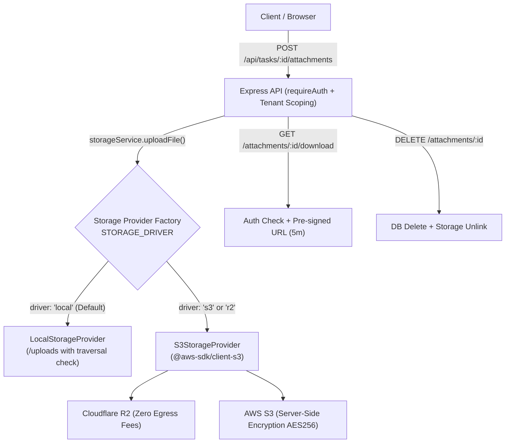

# PRD 04 — Secure Storage Architecture & S3/R2 Staging Integration Guide

> **Author:** Komal Khole (`feature/komal-prd04-verification`)  
> **Module:** PRD 04 — Task Collaboration, Attachments & Storage Integration  
> **Scope:** Cloudflare R2 / AWS S3 Production-Staging & Local Storage Fallback  

---

## 1. Executive Summary & Architectural Design

In PRD 04, task attachments must remain strictly confidential and multi-tenant isolated. Direct public bucket access is prohibited. Attachments are saved to private object storage and accessed solely through authenticated backend endpoints.

To ensure production staging readiness without adding rigid external dependencies to local developer environments or CI pipelines, we established a **Pluggable Storage Provider Pattern** ([`apps/api/src/services/storage.service.ts`](../apps/api/src/services/storage.service.ts)):



---

## 2. Supported Storage Drivers

### Driver A: `local` (Default for Local Development & CI)
* **Configuration:** `STORAGE_DRIVER=local` (or omit environment variable).
* **Behavior:** Files are persisted to `apps/api/uploads/`.
* **Path Traversal Defense:** Sanitizes all filenames via `path.basename()` and ensures resolved paths strictly stay within `uploads/`.
* **Zero Dependency:** Does not require AWS credentials, buckets, or internet access during testing.

### Driver B: `s3` or `r2` (For Production Staging & Production)
* **Configuration:** `STORAGE_DRIVER=s3` or `STORAGE_DRIVER=r2`.
* **SDK:** Implemented using standard AWS SDK v3 (`@aws-sdk/client-s3` and `@aws-sdk/s3-request-presigner`).
* **S3-Compatible Services:** Fully compatible with:
  1. **Cloudflare R2** (recommended for staging due to \$0 egress fees and high throughput)
  2. **AWS S3**
  3. **MinIO** (self-hosted / on-premise)

---

## 3. Environment Variables Specification

To enable S3 or Cloudflare R2 storage in staging, configure the following environment variables:

```bash
# ========================================================
# PRD 04: Storage Provider Configuration (S3 / Cloudflare R2)
# ========================================================

# Driver: "local" (default) | "s3" | "r2"
STORAGE_DRIVER="r2"

# S3 Bucket Name
S3_BUCKET="qveto-attachments-staging"

# S3 / R2 Region ("auto" for Cloudflare R2, "us-east-1" / "eu-west-1" for AWS S3)
S3_REGION="auto"

# Custom Endpoint (Required for Cloudflare R2; omit for standard AWS S3)
# Format for R2: https://<CLOUDFLARE_ACCOUNT_ID>.r2.cloudflarestorage.com
S3_ENDPOINT="https://abc1234567890def.r2.cloudflarestorage.com"

# IAM / API Credentials
S3_ACCESS_KEY_ID="your_access_key_id"
S3_SECRET_ACCESS_KEY="your_secret_access_key"

# Path style addressing (true for R2 / MinIO, false for AWS S3)
S3_FORCE_PATH_STYLE="true"

# Pre-signed Download URL Expiration in seconds (default: 300 = 5 minutes)
S3_PRESIGNED_EXPIRY_SECONDS=300
```

---

## 4. Security & Compliance Safeguards

1. **Private Buckets & Zero Public Access:**
   * Buckets must have **"Block All Public Access"** enabled.
   * Objects cannot be downloaded directly via public URLs.
2. **Short-Lived Pre-Signed URLs:**
   * When a client requests `/api/tasks/:taskId/attachments/:id/download`, the API first checks tenant and project membership.
   * If authorized, the backend generates an AWS S3 pre-signed URL valid for **300 seconds (5 minutes)**.
   * The download URL includes `ResponseContentDisposition: attachment; filename="..."` to force browser download and prevent cross-site scripting (XSS) via uploaded HTML/SVG files.
3. **Server-Side Encryption:**
   * All uploads initiated by `S3StorageProvider` specify `ServerSideEncryption: 'AES256'` (`aws:kms` or standard AES).
4. **Collision Defense & Storage Keys:**
   * File storage keys are generated using cryptographically random UUIDs (`${uuidv4()}${extension}`) so malicious users cannot overwrite existing files or guess file URLs.
5. **Least-Privilege IAM Policy (for AWS S3 / R2):**
   ```json
   {
     "Version": "2012-10-17",
     "Statement": [
       {
         "Sid": "QvetoAttachmentStorageAccess",
         "Effect": "Allow",
         "Action": [
           "s3:PutObject",
           "s3:GetObject",
           "s3:DeleteObject"
         ],
         "Resource": "arn:aws:s3:::qveto-attachments-staging/*"
       }
     ]
   }
   ```

---

## 5. Attachment Cleanup Lifecycle

* **Individual Attachment Deletion:**
  When `DELETE /api/tasks/:taskId/attachments/:id` is invoked:
  1. Database record is deleted inside a transaction.
  2. `ATTACHMENT_DELETED` activity event is emitted.
  3. The physical file is deleted from storage (`storageService.deleteFile(attachment.storagePath)`).
* **Task Attachment Cleanup:**
  When tasks are purged or cleaned up:
  `attachmentService.cleanupTaskAttachments(taskId)` retrieves all attachments, executes bulk deletion on storage (`storageService.deleteFiles(paths)`), and clears database records.
* **Error Resilience:**
  If a file was already removed from storage, database deletion still succeeds gracefully without throwing unhandled exceptions.
